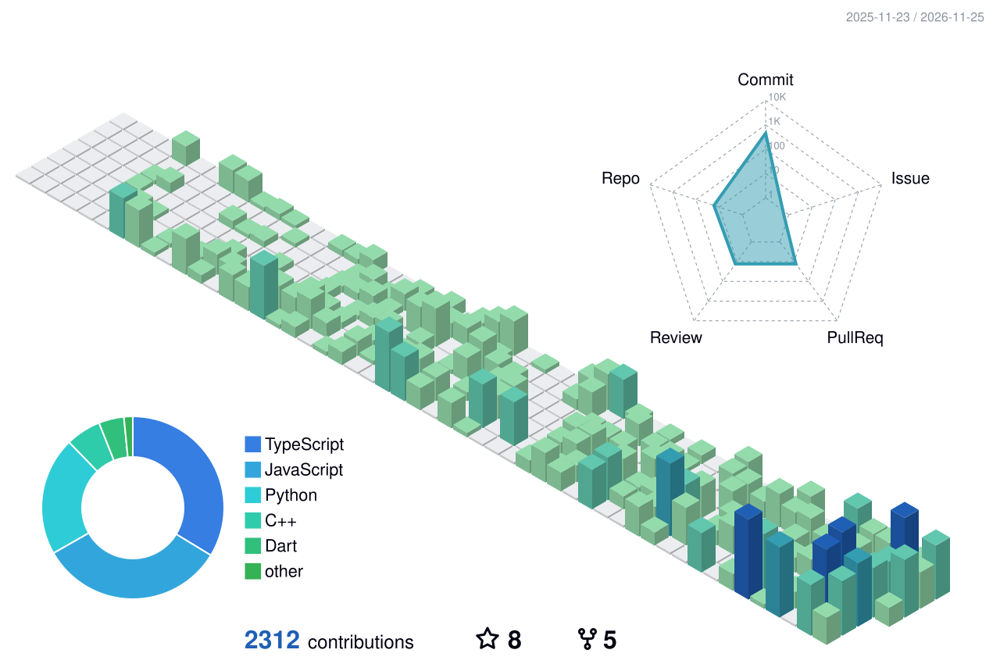

  

  <em>I like to build (...and break) things</em>

  
  
  

## About
-  Incoming **Software Engineer Intern, Data Platform/Analytics** @ *Microsoft* (Summer 2027)
-  Incoming **Client Engineering Intern, Data & AI** @ *IBM* (Fall 2027)
-  **President** @ *Google Developer Group Sheridan*
-  Prev **Software Engineer Intern** @ *Scotiabank*, AOO Award (5 of 245 interns)
 

- **Data Scientist Intern** @ *Oakville Futsal Club*
- Prev **AI/ML Engineer Intern** @ *Flite Transport, Town of Oakville*
- **CS - Data Engineering** @ *Sheridan College*
- Focused on **Innovating** with AI, creating with **Data**, and full-stack **PoCs**
- Hacking and building in public since **2024**

## Toolbox
**Languages**

  

**Frameworks & Libraries**

  

**Cloud & DevOps**

  

**Databases**

  

**Tools**

  

## Cool Projects
| Project | What it is | Stack |
|---|---|---|
| [Ember](https://github.com/georgef166/Ember) North America Winner @ Google Solution Challenge 2026, 'Spur Innovation' Track @ HackCanada 2026 | An XR firefighter system with software integrated into a mask-mounted headset, plus a commander hub that can place XR guidance objects and highlight doors/hazards in firefighters' view. | TypeScript + Next.js + WebRTC |
| [Voxel](https://github.com/georgef166/GenAIGenesis2026) Best AI Hack using IBM Tech @ GenAI Genesis 2026 | An XR education experience for children that turns learning into an interactive, engaging activity. | Dart + Flutter + Meshy API |
| [Rocky](https://github.com/georgef166/DeerHacks2026) 2nd Place + Best Use of Vultr @ DeerHacks V | A child safety app that detects risky situations and sends clear, real-time alerts to parents. | TypeScript + Next.js + Gemini API |
| [A11Yson](https://github.com/georgef166/A11Yson) Hackville 2026 | An accessibility Chrome extension that adapts any website into easier reading modes for different learning and sensory needs. | TypeScript + FastAPI + Chrome Extension |

## 3D Commit History
<!--
  Regenerated daily by .github/workflows/profile-3d.yml.
  Colours come from .github/profile-3d-settings.json (green -> blue ramp,
  with a separate palette for dark-mode viewers). Edit contribColors there.
-->

  

## Connect
- LinkedIn: [George Farag](https://www.linkedin.com/in/gfarag/)
- Website: [georgefarag.ca](https://georgefarag.ca/)
- GitHub: [@georgef166](https://github.com/georgef166)
